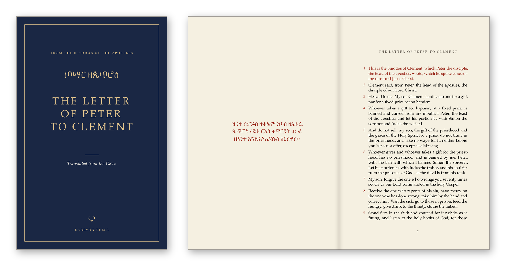

  <picture>
    <source media="(prefers-color-scheme: dark)" srcset="mark-dark.svg">
    <source media="(prefers-color-scheme: light)" srcset="mark.svg">
    
  </picture>

# The Letter of Peter to Clement

The Ethiopian Orthodox Tewahedo Church keeps a book called the Sinodos. It holds the ordinances of the apostles, which the Church has received as given by the apostles through Clement, the disciple of Peter, and it is counted among the books of the Church's New Testament.

This letter stands with those ordinances. In it Peter speaks to Clement as a father to a son. He tells him that baptism and priesthood are never to be sold, how the poor man is to be received at table, when to fast and when to pray, which feasts to keep, how the dead are remembered, how an altar is consecrated and what may be brought to it. He says what the incense is. The letter ends on the Mount of Olives.

It is given here whole, in English, translated from Ge'ez, the language of the Church's books.

  

**[Read or download the PDF](letter_of_peter_to_clement.pdf)** (20 pages)

The Ge'ez is the text printed in the Church's collection of the Sinodoses, the *Book of the Sinodos of the Apostles* (መጽሐፈ ሲኖዶስ ዘሐዋርያት), prepared with an Amharic translation by Megabe Mistir Semachew Nigatu (Bahir Dar, 2014 in the Ethiopian calendar), pages 382 to 410. The verse numbers are that edition's.

If you find an error in the translation, please [open an issue](../../issues).

---

English translation © 2026 Dacryon Press. Anyone may copy it and pass it on, whole and unchanged and with this notice, under the [Creative Commons Attribution-NoDerivatives 4.0 International license](https://creativecommons.org/licenses/by-nd/4.0/).
